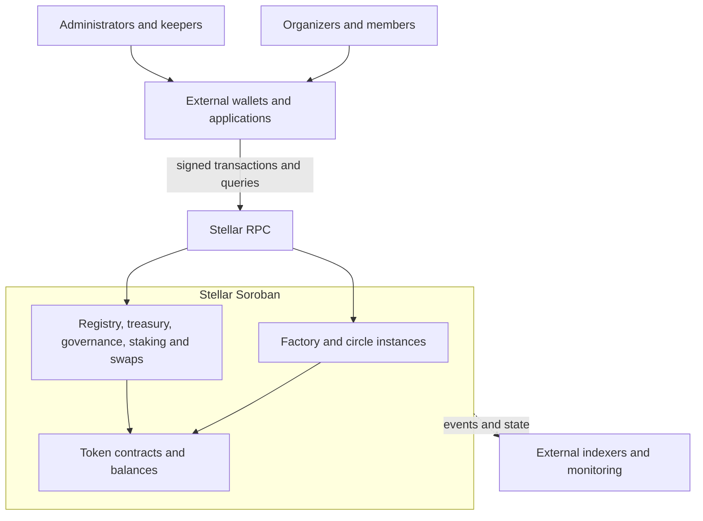
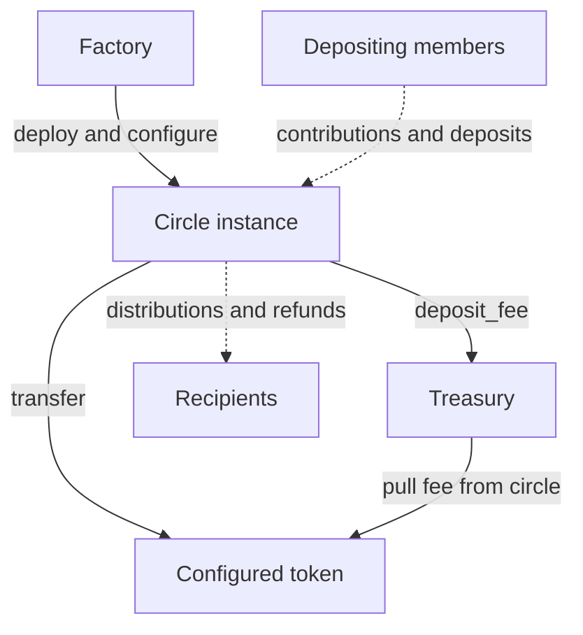
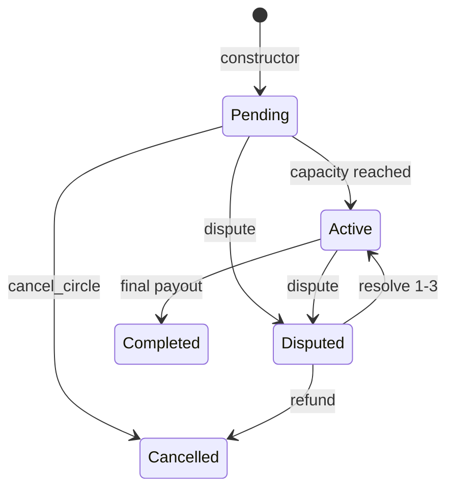
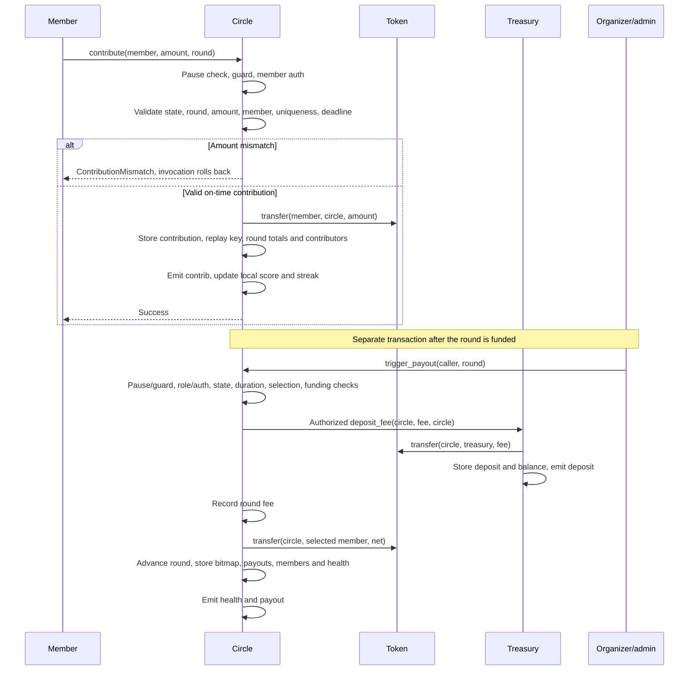

# Loki-app

**Configurable savings circles and supporting financial contracts on Stellar Soroban.**

Loki-app provides contracts for savings-circle organizers and members, and interfaces for engineers building financial applications. A savings circle—**Ajo, Esusu, or ROSCA** (Rotating Savings and Credit Association)—pools regular contributions and distributes the pot over successive rounds.

The workspace contains **eight contract implementations and one shared library**. Funds and protocol state live on-chain; wallets, transaction submission, reminders, indexing and user interfaces are external. The Go code provides error classification, with no running backend.

**Status:** targeted validation passed 186 unit tests and 35 doctests across seven crates (one example ignored); the circle WASM builds. Workspace verification remains blocked. Workspace builds currently fail on undefined staking pagination symbols; circle tests reference a missing root `circle.rs`. Deployment scripts also need corrections. No deployment, audit or coverage result is established here. See [validation](#testing-and-validation).

**Example:** five members each contribute `100_0000000` base units of a token with seven decimals: 100 tokens each, 500 total. With **Fixed** mode, five rounds numbered **0–4**, and a configured fee of **50 basis points**, each funded round pays its selected member **497.5 tokens** and deposits **2.5 tokens** into the treasury. This assumes timely payments, zero collateral, matching circle/treasury tokens, and no administrative withdrawals. The fee is configurable, not an immutable protocol rate. [Fee arithmetic](packages/common/src/math.rs), [distribution](packages/circle/src/contract.rs).

Canonical repository: [Blackdavid1/Lokin-app](https://github.com/Blackdavid1/Lokin-app). Product prose follows `Loki-app` in the current project documents; the repository slug is `Lokin-app`. Existing Rust identifiers and the Go module `github.com/blurbeast/loki-app` remain unchanged.

## Contents

- [Architecture and custody](#architecture-and-custody)
- [Circle behavior](#circle-behavior)
- [Supporting protocols](#supporting-protocols)
- [Trust and operational limits](#trust-and-operational-limits)
- [Repository and design](#repository-and-design)
- [Development](#development)
- [Testing and validation](#testing-and-validation)
- [Contributing and license](#contributing-and-license)

## Architecture and custody



Contract exports live in `src/lib.rs`. Clients/indexers are external; [Go utilities](pkg/stellar/soroban/errors.go) do not submit transactions.

### Component catalog

Interfaces are representative exports. Assets are balances at contract addresses in the configured token contract.

| Component | Responsibility | Public interface | Owned state/assets | Collaborators | Source |
|---|---|---|---|---|---|
| `circle-factory` | Deploy and register circles | `init_with_config`, `deploy_circle`, configuration/query methods | WASM hash, configurations, registry, organizer quotas | Creates and configures circles | [Exports](packages/circle-factory/src/lib.rs) |
| `circle` | Membership, rounds, payouts, disputes | `join`, `contribute`, `trigger_payout`, deadline/auction/vote/admin methods | Contributions, collateral, bid deposits; members, rounds, local scores | Token, treasury, optional oracle; conditional registry query during initialization | [Exports](packages/circle/src/lib.rs) |
| `reputation-registry` | Two reputation representations | `record_activity`, `get_score`, `record_on_time_payment`, `get_moi_score`, tier queries | Scores, streaks, activity history; no tokens | Member-authorized updates | [Exports](packages/reputation-registry/src/lib.rs) |
| `treasury` | Receive and account for fees | `init`, `deposit_fee`, `withdraw`, `rescue_tokens` | Configured-token balance and deposit/withdrawal records | Token; depositing circles | [Exports](packages/treasury/src/lib.rs) |
| `staking` | Lock tokens and expose voting power | `stake`, `top_up`, `unstake`, `claim`, slash methods | Stake/unbonding records and deposited tokens | Configured token; queried by governance | [Exports](packages/staking/src/lib.rs) |
| `governance` | Vote on arbitrary contract calls | `create_proposal`, `cast_vote`, `finalize_proposal`, `execute_proposal`, `delegate` | Proposals, votes, delegation, nominal deposits | Optional staking; proposal target | [Exports](packages/governance/src/lib.rs) |
| `governance-token` | Configurable fungible token | `initialize`, transfers, allowances, mint/burn, freeze/clawback | Balances, supply, allowances, restrictions | Usable where a compatible token is configured | [Exports](packages/governance-token/src/lib.rs) |
| `escrow-swap` | Two-token escrow exchange | `create_swap`, `accept_swap`, `complete_swap`, `cancel_swap` | Swap records and both deposits | Two configured tokens | [Exports](packages/escrow-swap/src/lib.rs) |
| `common` | Shared Rust utilities; not deployable | Math, pause, auth, TTL, randomness, transfer and upgrade helpers | Uses the calling contract's storage | Compile-time dependency of all contracts | [Modules](packages/common/src/lib.rs) |
| `pkg/` | Go domain-error translation | `ClassifySorobanError` | No ledger custody or service state | Caller supplies contract kind/code | [Mapping](pkg/stellar/soroban/errors.go) |

`deploy_circle(config)` authenticates the organizer, hashes the configuration for a deterministic salt, checks duplicates/quotas, and creates **one contract instance per circle** through `deploy_v2`. The organizer becomes circle admin. `configure_from_factory` then supplies treasury, reputation address and fees. Later factory settings affect future deployments. [Implementation](packages/circle-factory/src/contract.rs).



**Legend:** solid arrows are runtime calls; dashed arrows show economic fund flow through token balances. Ordinary payout fees reach treasury through `deposit_protocol_fee`; late penalties and batch-payout fees transfer directly and bypass treasury's deposit accounting. An optional primary/fallback oracle receives `yld_rate`; its returned rate is unused in payout arithmetic. [Circle](packages/circle/src/contract.rs), [treasury](packages/treasury/src/contract.rs), [oracle](packages/circle/src/oracle.rs).

## Circle behavior

### Membership and lifecycle

Factory creation requires positive contributions, at least two members, nonzero rounds, and payout type 0–3; the circle constructor caps membership at 100. The constructor itself permits zero contributions. Ordinary `join` requires member authorization, pending status, sufficient **local** MoiScore, an allowlist match when enabled, and no duplicate member. Positive configured collateral transfers into the circle; joining does not itself submit a round contribution. Reaching capacity activates it.



These are the lifecycle values in [types.rs](packages/circle/src/types.rs) and their ordinary transitions in [contract.rs](packages/circle/src/contract.rs). Joining or batch invitation to capacity activates a circle; intermediate payouts advance the round while remaining Active. Pause is a separate shared flag. Resolution codes 1/2/3 dismiss, penalize or request force-payout; all set `Active`. Code 4 requests refunds and cancels. `RESOLVE_FORCE_PAYOUT` does **not** transfer a payout. Resolving a dispute raised while pending also sets `Active`, rather than restoring the prior state.

Contributions must match the configured amount and current round exactly. Per-member/round keys reject duplicates; scheduling a payout blocks further contributions but does not execute anything. The deadline is `started_at + contribution_deadline_seconds`, with an optional grace interval. **`started_at` is not reset between rounds**, so these are not independent recurring payment windows. A zero deadline disables the window.

Grace-period payments are recorded as late. Their penalty is transferred **from the circle's existing balance**, not charged in addition to the member's contribution. After the grace boundary, contributions fail. Anyone may submit `check_contribution_deadline` after that boundary to strike absent active members and attempt settlement; organizer/admin `trigger_payout` can settle once everyone has paid or the window has closed. Neither path runs on a timer. `max_strikes` marks members defaulted. The separate `report_late` path currently increments strikes twice and does not reject repeated reports.

Pending cancellation refunds configured collateral to active members. `exit_circle` returns collateral and records a 5% contribution-based penalty in its event without collecting it. Normal positive-net completion returns collateral to active members. The zero-net settlement branch skips that completion cleanup. Dispute refund uses `Member.total_contributions`, which ordinary `contribute` does not increment; do not assume it refunds contribution history. These behaviors do not establish recovery guarantees. [Operations](packages/circle/src/contract.rs).

### Payout modes

All standard modes use `trigger_payout` or deadline settlement; selection helpers in `payout.rs` are **internal Rust functions**, not contract exports.

| Mode | Eligibility/selection | Actual fund distribution | Required trigger | Edge cases |
|---|---|---|---|---|
| Random (`0`) | Active, unpaid position from shared randomness helper, then fallback scan | Net pool shared by contribution amount × time held; remainder to selected recipient | Standard settlement | Zero total weight sends all net to selected member; recorded selection is not the sole beneficiary |
| Fixed (`1`) | Active, unpaid position `round % max_members` | Entire net pool to selected member | Standard settlement | Exited/defaulted selected position fails; paid bitmap prevents another turn |
| Auction (`2`) | Highest discount wins; last stored bid wins equal discounts; winner must be active/unpaid | Entire net pool; selected discount is ignored by transfer logic | Bids, then standard settlement | English bid deposits one contribution amount; winner deposit is retained; losing refunds require separate calls |
| Vote (`3`) | At least `floor(active/2)+1` recorded votes; highest tally wins, active/unpaid winner | Entire net pool | Member votes, then standard settlement | Equal tallies follow map iteration order; no separate merit mode |

[Selection](packages/circle/src/payout.rs) and [transfers](packages/circle/src/contract.rs) are deliberately documented separately. Randomness uses a PRNG-seeded salt and SHA-256 helper; the circle does not expose an external proof-fulfillment workflow. Configuring more rounds than available unpaid positions can prevent completion.

Dutch auctions share mode `2`: organizer configuration sets a discount that decays by ledger; the first bid records the clearing discount with **zero deposit**, then settlement remains separate. English losing deposits are refunded in batches capped at 20 by `refund_losing_bids`. `cancel_auction` refunds only the highest bid's contribution-derived amount and clears current bids; it is not a refund of every deposit. See [auction operations](packages/circle/src/contract.rs).

Amounts are integer token base units (`i128`); circle code does not normalize token decimals. Fee basis points range from 0 to 10,000. Positive fee arithmetic truncates `pool × bps / 10,000`; seven-decimal assumptions also appear in scoring thresholds. [Math](packages/common/src/math.rs).

### One contribution through settlement



This is a nonfinal **Fixed** round with positive fees, timely payment and no oracle configured. `Circle::contribute` delegates to `contract::contribute`; `trigger_payout_internal` calls `resolve_fixed`, then `deposit_protocol_fee`. Final-round completion additionally emits `complete`, returns active-member collateral and updates local completion scores. [Exports](packages/circle/src/lib.rs), [logic](packages/circle/src/contract.rs), [fee-transfer tests](packages/circle/src/test.rs).

## Supporting protocols

The supporting contracts expose separate reputation, governance, staking, token and swap interfaces; deployment does not wire them together automatically.

<details>
<summary>Scoring rules, governance deposits, staking locks and swap settlement</summary>

**Reputation:** circle joins, contributions, defaults and completion use `reputation_registry::scoring` as linked Rust code, accessing the **circle's storage**. The configured external registry is only conditionally queried for organizer limits during initialization; factory configuration arrives afterward, so normal factory construction does not enforce those external tier limits.

Enhanced MoiScore adds 10 per on-time payment, `min(5 × streak, 50)`, and up to 20 volume points (one per `100_0000000` units); completion adds 100, default subtracts 200, and explicit inactivity updates subtract 5 per 30 days. Scores are capped at 1,000. [Scoring](packages/reputation-registry/src/scoring.rs).

| Enhanced tier | Score | Max members | Contribution limit, seven-decimal tokens | Collateral bps |
|---|---|---|---|---|
| Bronze | 0–200 | 5 | 100 | 1,000 |
| Silver | 201–400 | 10 | 500 | 500 |
| Gold | 401–600 | 20 | 2,000 | 300 |
| Platinum | 601–800 | 50 | 10,000 | 100 |
| Diamond | 801–1,000 | 100 | 50,000 | 0 |

These limits do not replace configured collateral. Separate `record_activity`/`get_score` records use thresholds **200/400/600/800**. Both update interfaces authenticate members but accept caller-supplied activity without verifying protocol execution. [Registry exports](packages/reputation-registry/src/lib.rs), [records](packages/reputation-registry/src/contract.rs), [storage](packages/reputation-registry/src/storage.rs).

**Governance and staking:** governance queries configured staking `get_voting_power` at vote time, or assigns power 1 without staking. Delegation aggregates direct delegators and rejects chains. Participation including abstentions must reach absolute `quorum_votes`; support excludes abstentions. Proposals start `Active`, finalize to `Queued` or `Defeated`, and execute a configured target call after a configurable timelock. Cancellation before votes and explicit expiry paths exist. Admin configuration updates have a separate 48-hour delay. **Proposal deposits/refunds/forfeitures are records and events; no tokens move.** Target contracts must independently permit the proposed action. [Governance logic](packages/governance/src/contract.rs).

Staking holds the configured token for 30/90/180/360 days with voting multipliers 1/2/3/5 and a minimum stake of `1_0000000` base units. Unstake after unlock starts 14-day unbonding; a separate authorized claim returns tokens at or after its deadline. Top-ups preserve unlock time. Admin can slash immediately or use a notice workflow (default 24 hours, configurable); both reduce stake accounting without transferring slashed tokens. Governance-token integration is by configured token address, not automatic wiring. [Staking logic](packages/staking/src/contract.rs), [periods](packages/staking/src/types.rs).

**Swaps:** creation escrows initiator token A; acceptance by the designated responder verifies a 32-byte secret's SHA-256 hash, checks `now < time_lock`, and escrows token B. Either party separately completes the exchange. Either party can cancel pending/active swaps and refund deposited assets **without waiting for timeout**; completion has no timeout check. [Swap logic](packages/escrow-swap/src/contract.rs).

</details>

## Trust and operational limits

| Role | Authority and custody implications |
|---|---|
| Circle organizer/admin | Standard and batch payouts; `withdraw_treasury` actually transfers **circle-held tokens to the caller**. Positive per-transaction/day caps apply; zero disables a cap. The day is a UTC bucket. |
| Circle admin | Pause/unpause, token/treasury/fee/allowlist/oracle settings, dispute resolution. Factory-created circles use organizer as admin. |
| Organizer | `batch_invite` inserts members without member authorization, collateral transfer, or the ordinary allowlist check. |
| Factory/registry admins | Their own pause and configuration controls; not automatically administrators of existing circles. |
| Treasury admin | Withdraw accounted funds to a chosen address; rescue tokens while paused. |
| Staking/governance admins | Pause, staking slashes/admin changes; governance staking configuration and delayed parameter updates. |
| Token admin | Mint, freeze/unfreeze, allowlist, admin burn/clawback, transfer admin authority. |
| Swap admin; participants | Admin pauses; participants authorize deposits, completion and cancellation. |

Permissions combine [inline checks](packages/) and shared [pause](packages/common/src/pause.rs)/[access](packages/common/src/access.rs) helpers. Factory, treasury, registry and staking initialization lack one-time guards; initialization authority is a material trust assumption.

Ordinary payout fees use treasury accounting; direct penalty/batch transfers do not. Circle `batch_payout` accepts up to ten caller-selected recipients/amounts and does not advance the round. Shared custody means collateral, contributions and deposits are not isolated token accounts. No guaranteed solvency or complete refund behavior is claimed.

Checked math, saturating operations, replay keys and payout bitmaps appear throughout; not every arithmetic path is checked. Selected money-moving entry points use a temporary-storage RAII [reentrancy guard](packages/common/src/reentrancy.rs). A failed Soroban invocation rolls back its state/token effects; that does not make every permitted state transition correct.

Circle configuration uses instance storage; member/history vectors and round indexes use persistent storage. Staking positions are in instance storage; token balances are a persistent map. Registry reads/writes extend TTL using [shared policies](packages/common/src/ttl.rs) (instance 7→30 days, persistent 30→90 days in assumed five-second ledgers). This maintenance is not universal. Persistent storage can be archived; it is not a promise of perpetual availability. [Stellar storage guide](https://developers.stellar.org/docs/build/guides/storage/use-persistent).

[Upgrade helpers](packages/common/src/upgrade.rs) can store an implementation address or replace current WASM, but **no deployable contract exports `upgrade` or forwards calls through a proxy**. The helpers require authorization of a supplied address without checking a stored admin. State migration/upgrade compatibility is not demonstrated.

## Repository and design

| Path | Responsibility |
|---|---|
| `packages/` | Eight contract crates and `common`; package READMEs are supplementary, sometimes stale |
| `pkg/apperrors/`, `pkg/stellar/soroban/` | Go domain errors, classification and tests |
| `scripts/` | Deployment, upgrade, bindings and WASM size tooling |
| `.github/workflows/` | Two Rust CI workflows |
| `.vscode/`, `.editorconfig`, `.rustfmt.toml` | Editor and formatting settings |
| `Cargo.toml`, `Cargo.lock`, `rust-toolchain.toml` | Workspace, resolved dependencies, pinned compiler/targets |
| `go.mod` | Go 1.22 module; no external Go dependencies |
| `Makefile`, `clippy.toml`, `deny.toml` | Build wrappers and lint/dependency policy configuration |
| `AGENTS.md`, `CONTRIBUTING.md`, `LOKI_APP_README.md`, `LICENSE` | Contributor guidance, historical product context and license |

There is no current `docs/` directory. Generated WASM, build trees and test snapshots are omitted from this map.

A contract's `Cargo.toml` defines compile-time dependencies; `src/lib.rs` defines SDK exports; `contract.rs` implements operations; `types.rs` defines records, keys, events and typed numeric errors. Exceptions include governance-token's symbol keys in `contract.rs`. Circle separates recipient selection into `payout.rs` and oracle calls into `oracle.rs`; reputation separates `scoring.rs` from `storage.rs`. `test.rs` and circle's `tests/` contain tests and setup fixtures.

Factory isolation costs a deployment/configuration per circle. Thin exports separate ABI from operations, but linked helpers share caller storage. Precomputed totals/replay indexes accelerate reads while requiring consistency with history vectors. Payout dispatch separates selection from shared transfers, requiring both paths to understand distribution. Events support indexing; storage remains authoritative.

## Development

Use the [pinned toolchain](rust-toolchain.toml): **Rust 1.93.0**, edition 2021; workspace metadata lists Rust 1.91. [Cargo.lock](Cargo.lock) resolves Soroban SDK/token SDK **26.0.0**. The contract workflow pins **`soroban-cli` 28.1.0 with `opt`**; these version numbers need not match. Make/CI use **`wasm32v1-none`**; the toolchain also installs `wasm32-unknown-unknown`. Go utilities require **Go 1.22+**.

The ordered local path below reflects [Contracts CI](.github/workflows/contracts.yml). Workspace builds/tests currently fail on staking pagination symbols; missing `circle.rs` also blocks circle tests and formatting. These commands expose the blockers rather than bypass them. For a focused WASM build, use `cargo build --locked -p circle --target wasm32v1-none --release`.

```bash
git clone https://github.com/Blackdavid1/Lokin-app.git
cd Lokin-app
rustup toolchain install 1.93.0 --component rustfmt --component clippy \
  --target wasm32v1-none --target wasm32-unknown-unknown
cargo install --locked soroban-cli --version 28.1.0 --features opt

cargo build --locked --workspace --target wasm32v1-none --release
soroban contract optimize --wasm target/wasm32v1-none/release/circle.wasm
mkdir -p packages/circle-factory/test_wasm
cp target/wasm32v1-none/release/circle.optimized.wasm \
  packages/circle-factory/test_wasm/contract.wasm

cargo test --locked -p common
cargo test --locked -p circle test_trigger_payout_transfers_tokens_and_deposits_fee
cargo test --locked --workspace
cargo fmt --all -- --check
cargo clippy --locked --workspace -- -D warnings
go test ./pkg/... -race -count=1
```

Factory tests embed the optimized fixture with `include_bytes!`; raw WASM can exceed host write limits. The optimized fixture passed factory tests locally. Host tests use the SDK ledger harness, not a standalone network. No local validator launcher is included.

<details>
<summary>Build wrappers, bindings and network preparation</summary>

`make build` writes `target/wasm32v1-none/release/`; `make optimize` covers only circle/factory/registry/treasury. `make test` runs workspace tests; `make fmt` checks formatting. `test-coverage` only tails output, measuring no coverage. `make check` masks clippy failures; prefer explicit checks. `make clean` removes build output and `bindings/`.

`make bindings` calls [bindings.sh](scripts/bindings.sh) for JS/TS despite its Go label, omitting the required language subcommand. With local Stellar CLI 28.0.0:

```bash
stellar contract bindings typescript \
  --wasm target/wasm32v1-none/release/circle.wasm \
  --output-dir bindings/circle --overwrite
```

This requires built WASM. No generated Go client exists here.

**Deployment scripts need correction.** [deploy.sh](scripts/deploy.sh) consumes optimized WASM and `TESTNET_ADMIN_PUBLIC_KEY`/`TESTNET_ADMIN_SECRET_KEY` (or `MAINNET_` equivalents), configures an identity, deploys factory/registry/treasury and installs circle WASM. It omits treasury's required `token` argument and suppresses initialization failures.

[deploy-upgrade.sh](scripts/deploy-upgrade.sh) needs Bash 4+, `jq`, the same credentials and [manifest](scripts/deploy-manifest.json); it writes `deployments/<network>-<timestamp>.json`. Treasury token is missing, factory arguments target the wrong initializer, and upgrade mode calls nonexistent exports. Dry-run still expects credentials and writes logs. Neither script covers all eight contracts.

Before deployment, repair scripts, choose matching circle/treasury tokens, initialize registry/treasury, install circle WASM and call factory `init_with_config`. Capture actual IDs/hashes and verify state; keep credentials out of source control. No network operations were executed.

</details>

## Testing and validation

The evidence below identifies test **intent**, not a blanket passing result or coverage claim.

| Claim → implementation | Test/operational evidence | Limitation |
|---|---|---|
| Factory creates/configures instances → `deploy_circle` | [Factory tests](packages/circle-factory/src/test.rs): deployment, canonical duplicate, config propagation | Requires optimized embedded WASM |
| Contribution transfers and fees → `contribute`, `trigger_payout_internal` | [Circle tests](packages/circle/src/test.rs): amount/auth, lifecycle, fee balances, late penalties | Missing `circle.rs` prevents current suite compilation |
| Multi-contract fee path | [Integration tests](packages/circle/src/tests/test_integration.rs) register real circle, treasury and token contracts locally | Full factory→circle→treasury test is ignored and contains only a placeholder assertion |
| Replay, deadline and reentry guards | [Hardening](packages/circle/src/tests/test_security_hardening.rs), [invariants](packages/circle/src/tests/test_invariants.rs) | Invariant test checks an accounting inequality, not every custody path |
| Scale and resource limits | [Stress](packages/circle/src/tests/test_stress.rs), [budget](packages/circle/src/tests/test_gas_budget.rs) tests | CPU budget assertions are not testnet latency measurements |
| Shared arithmetic/randomness | [Common tests](packages/common/src/test.rs), inline math tests | Includes property tests, not whole-protocol fuzz coverage |
| Supporting protocol behavior | [Staking](packages/staking/src/test.rs), [governance](packages/governance/src/test.rs), [token](packages/governance-token/src/test.rs), [swap](packages/escrow-swap/src/test.rs), [treasury](packages/treasury/src/test.rs), [registry](packages/reputation-registry/src/test.rs) | Several crates also contain trivial compile-smoke assertions |

Circle event topics include `joined`, `contrib`, `late_pen`, `payout`, `health`, `complete`, and dispute/refund topics. Payloads and numeric errors are defined in [circle types](packages/circle/src/types.rs); other contracts have their own types modules. Consumers must distinguish summary payout records from actual transfers, especially in Random mode.

The Go [classifier](pkg/stellar/soroban/errors.go) and [tests](pkg/stellar/soroban/errors_test.go) are partial: staking maps codes 1–11 while Rust uses 100–119; governance mappings also differ, and governance-token/escrow kinds fall through to circle mapping. Inspect the relevant Rust error enum before integration.

[CI](.github/workflows/ci.yml) runs format, clippy, workspace tests, then WASM size checks for pushes/PRs targeting `main`; it does not stage the factory fixture. [Contracts CI](.github/workflows/contracts.yml) stages that fixture; pushes require `main` and matching source paths, while PRs use path filters without a branch restriction. The inspected branch is **`master`**, so its pushes do not trigger either workflow. [Size checks](scripts/check-wasm-size.sh) cover only five contracts and skip missing binaries.

<details>
<summary>Local verification — 2026-11-03, master at 018c013e623c0632200c34cad5b2d9bd64427e26</summary>

Source was clean before documentation work. Checks used Rust 1.93.0 and a temporary copy; optimization/bindings used the available Stellar CLI 28.0.0, not CI's 28.1.0. Commands below were run from the repository root; Cargo commands used the explicit `+1.93.0` override.

| Command/check | Result |
|---|---|
| `cargo +1.93.0 build --locked --workspace --target wasm32v1-none --release` | **Failed:** staking references undefined `StakersPage`, `StakerEntry`, `MAX_STAKERS_PAGE_SIZE` |
| `cargo +1.93.0 build --locked -p circle --target wasm32v1-none --release` | **Passed**, with warnings |
| `stellar contract optimize --wasm target/wasm32v1-none/release/circle.wasm` | **Passed:** 162,551 → 122,628 bytes; optimized fixture staged |
| `cargo +1.93.0 test --locked --workspace` | **Failed** compiling staking; no complete workspace result |
| `cargo +1.93.0 test --locked -p common -p treasury -p reputation-registry -p governance -p governance-token -p escrow-swap` | **Passed:** 156 unit tests and 32 doctests; one reentrancy example ignored |
| `cargo +1.93.0 test --locked -p circle test_trigger_payout_transfers_tokens_and_deposits_fee` | **Failed:** missing root `circle.rs` |
| `cargo +1.93.0 test --locked -p circle-factory` | **Passed:** 30 unit tests, 3 doctests, using the staged fixture |
| `cargo +1.93.0 fmt --all -- --check` | **Failed:** missing `circle.rs`, existing format differences and nightly-only options |
| `cargo +1.93.0 clippy --locked --workspace -- -D warnings` | **Failed:** unknown `large-stack-arrays-threshold` in `clippy.toml` |
| `bash scripts/check-wasm-size.sh target/wasm32v1-none/release` | **Failed:** circle, factory and registry exceed their budgets; treasury/governance pass |
| Mermaid CLI 11.4.2, all four diagrams | **Passed:** rendered and visually reviewed in light/dark themes |
| Local links, TOC anchors and whitespace | **Passed** |
| Explicit TypeScript binding command above | **Passed:** package generated locally; generated package was not built |
| `go test ./pkg/... -race -count=1` | **Not run:** `go` executable unavailable |

No deployment, audit, coverage measurement, sanitizer run or phase-completion certification was performed.

</details>

## Contributing and license

Start reading: [circle types](packages/circle/src/types.rs) → [exports](packages/circle/src/lib.rs) → `contribute`/`trigger_payout_internal` in [operations](packages/circle/src/contract.rs) → [selection](packages/circle/src/payout.rs) → [tests](packages/circle/src/test.rs) → [factory deployment](packages/circle-factory/src/contract.rs).

Follow [AGENTS.md](AGENTS.md) and [CONTRIBUTING.md](CONTRIBUTING.md); preserve ABI/error compatibility and test lifecycle, authorization and token balances. Prefer commands above over stale Rust 1.91.0/`make fmt-check` guidance. [LOKI_APP_README.md](LOKI_APP_README.md) is historical context.

Licensed under [Apache-2.0](LICENSE). The current notice reads **Copyright 2026 Loki-app contributors**. The repository retains its earlier Moistello commit history and existing attribution; rebranding does not replace contributors' rights or license obligations.
